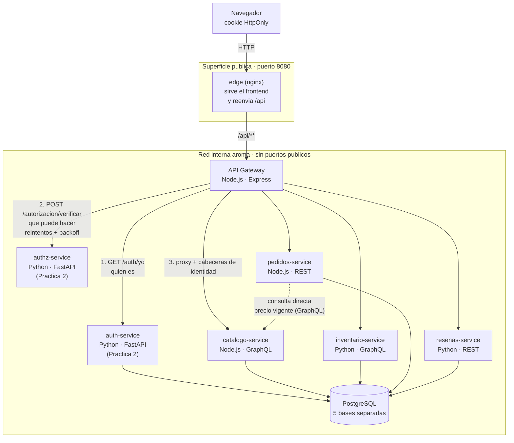
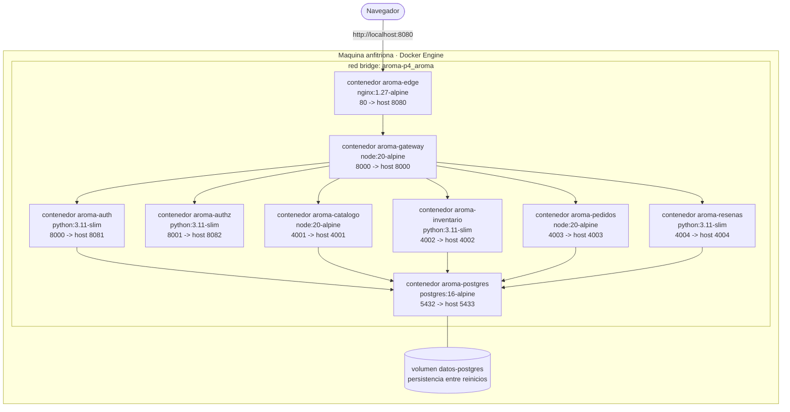
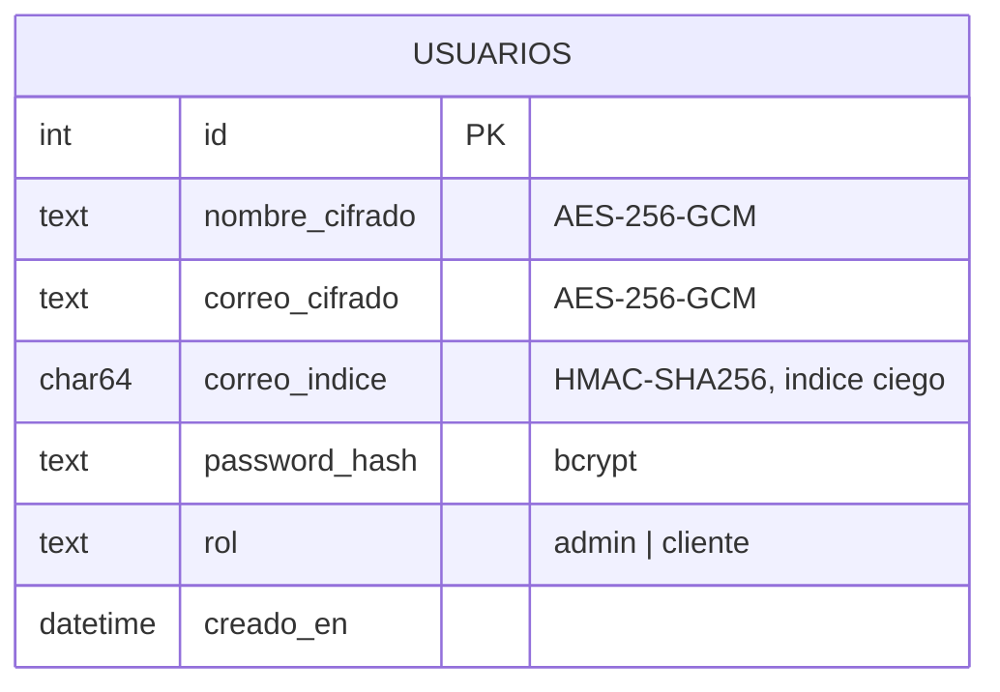
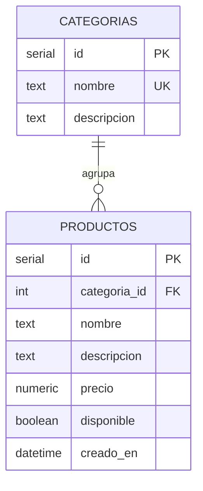
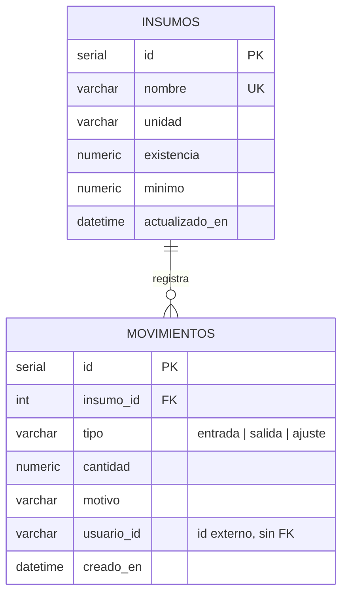
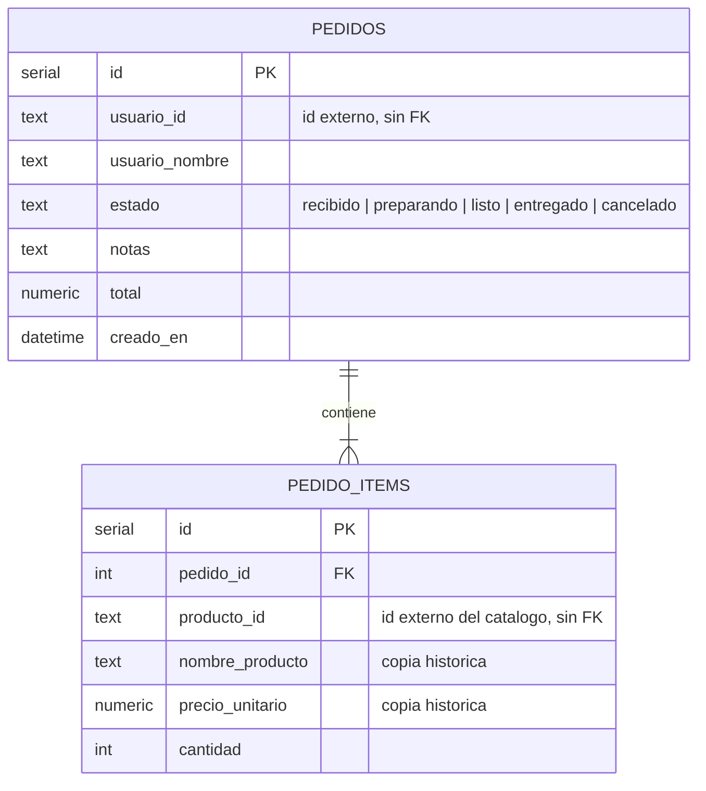
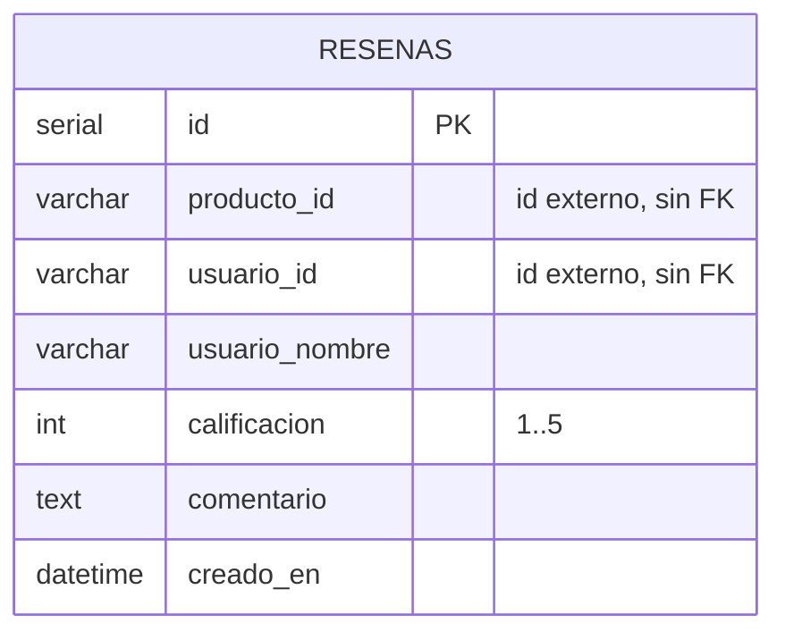

# Arquitectura de Aroma

Los tres diagramas que exige la practica: comunicacion entre servicios,
despliegue y modelo entidad-relacion. Estan en Mermaid, asi que GitHub los
renderiza directamente en el navegador; el codigo fuente sirve ademas como
documentacion versionable.

---

## 1. Diagrama de arquitectura (comunicacion entre servicios)

### Como se lee

1. El navegador nunca habla con un microservicio: solo con el **edge**.
2. El **gateway** resuelve dos preguntas distintas antes de reenviar nada.
   *Quien eres* se la hace al servicio de autenticacion, que es el unico que
   conoce el secreto del JWT. *Que puedes hacer* se la hace al microservicio
   de autorizacion, que es el unico que conoce la matriz de permisos.
3. Si ambas responden que si, el gateway reenvia la peticion agregando
   `X-Usuario-Id`, `X-Usuario-Rol` y `X-Usuario-Nombre`. Los servicios de
   negocio no abren tokens: reciben una identidad ya verificada.
4. La flecha punteada es la unica comunicacion directa entre microservicios:
   pedidos le pregunta al catalogo el precio vigente en lugar de guardar una
   copia que se desincronizaria.

---

## 2. Diagrama de despliegue

Los puertos publicados hacia el host, salvo el 8080, existen solo para
depurar y calificar (abrir `/docs` de FastAPI, el sandbox de GraphQL). En un
despliegue real se cierran todos menos el del edge.

### Salida al exterior: hoy y manana

En Docker Compose el punto de entrada es el contenedor `edge`, que publica
el puerto 8080. Ese contenedor cumple el papel que en Kubernetes cumpliria
un `Service` de tipo `LoadBalancer` o un `Ingress`. En
[exposicion-externa.md](exposicion-externa.md) esta la equivalencia y los
manifiestos de ejemplo en la carpeta `k8s/`.

---

## 3. Diagrama entidad-relacion

Cada microservicio tiene su **propia base de datos**. No hay llaves foraneas
que crucen la frontera de un servicio: la relacion entre un pedido y un
producto se guarda como un identificador suelto, y la resuelve una llamada a
la API, no un `JOIN`.

### auth_db · servicio de autenticacion (Practica 2)

### catalogo_db · catalogo

### inventario_db · inventario

### pedidos_db · pedidos

`nombre_producto` y `precio_unitario` se copian a proposito. Si manana sube
el precio del latte, los pedidos de ayer deben seguir mostrando lo que se
cobro entonces. Es la diferencia entre un dato de referencia y un dato
historico.

### resenas_db · resenas

Restriccion `UNIQUE (producto_id, usuario_id)`: una persona opina una vez
por producto. Sin ella, cualquiera podria inflar el promedio repitiendo la
misma resena.
