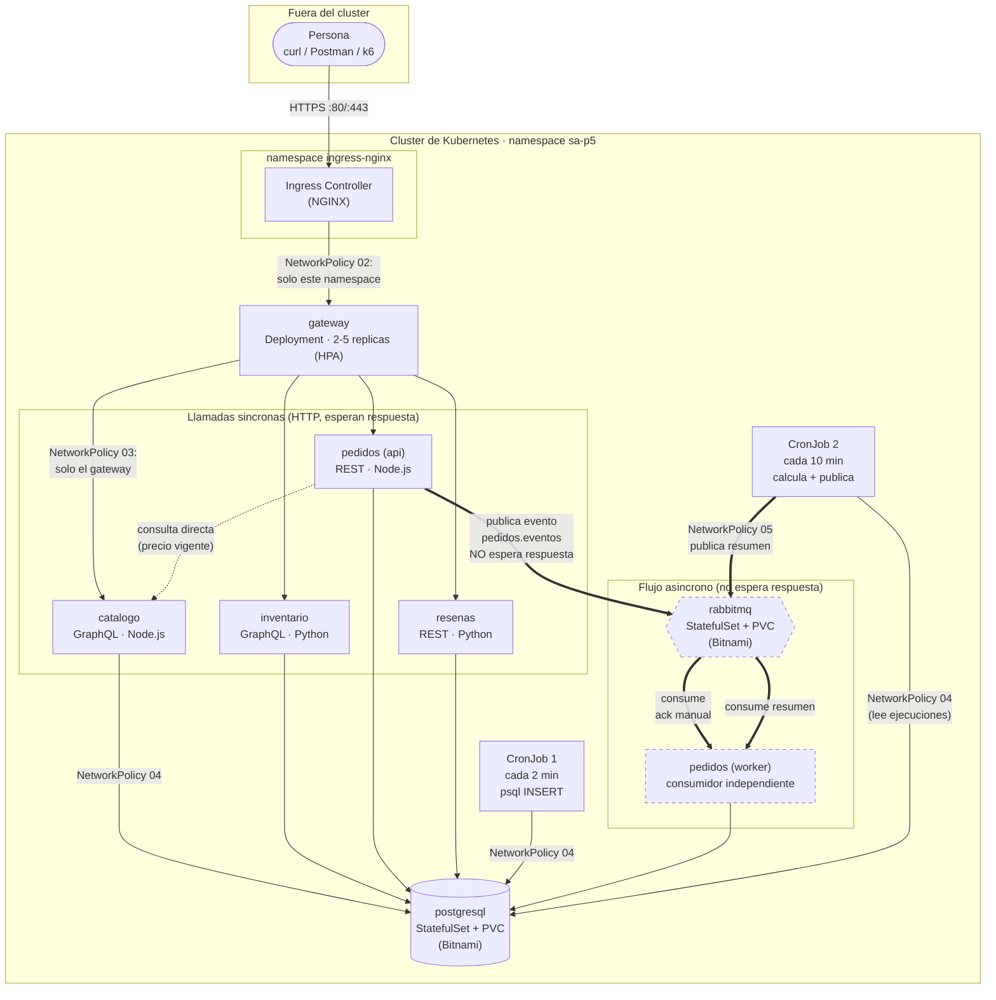
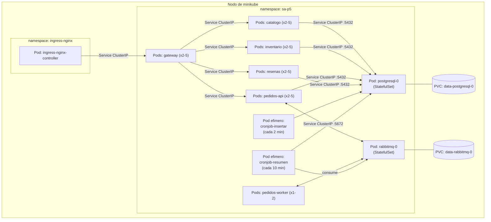

# Arquitectura de Aroma — Práctica 5

## 1. Diagrama de arquitectura (interno/externo, síncrono/asíncrono, límites de red)

**Cómo leerlo:**

- **Flechas finas (`-->`)**: llamadas síncronas por HTTP. Quien llama espera la respuesta antes de continuar (el gateway esperando a catalogo, pedidos consultando el precio vigente al catalogo, cualquier servicio hablando con Postgres).
- **Flechas gruesas (`==>`)**: el flujo asíncrono. `pedidos (api)` publica en RabbitMQ y responde al cliente HTTP de inmediato, sin esperar a que `pedidos (worker)` procese nada. El worker consume cuando puede, incluso minutos después.
- **Los límites marcados como "NetworkPolicy N"** son exactamente los que aplican los archivos `templates/networkpolicy-0N-*.yaml` del chart. Fuera de esas flechas, todo tráfico está bloqueado por la política `default-deny-ingress` (política 01): es la razón por la que el diagrama no muestra, por ejemplo, una flecha directa entre `resenas` y `rabbitmq`, o entre cualquier Pod fuera del namespace y `postgresql`.
- **Lo que queda fuera del cluster**: únicamente quien hace la petición HTTP. Ni la base de datos, ni el broker, ni ningún microservicio tienen una IP alcanzable desde fuera; la única superficie pública es el Ingress.

## 2. Diagrama de despliegue

Todos los objetos de este diagrama, salvo el nodo físico de minikube, los crea `helm install` en una sola invocación. Ningún Pod se expone con `NodePort` ni `LoadBalancer`: el único camino de entrada es el `Ingress` del subchart `gateway`.

## 3. Notas de diseño que sostienen la arquitectura

**Por qué Postgres y RabbitMQ son dependencias de Bitnami y no manifiestos propios.** Ambos ya se despliegan como `StatefulSet` con `PersistentVolumeClaim` y `Service` headless, que es exactamente el requisito C. Escribirlos a mano hubiera duplicado trabajo ya resuelto y probado por la comunidad, y esta práctica evalúa saber *empaquetar y operar* con Helm, no reimplementar un operador de base de datos.

**Por qué el gateway de esta práctica no verifica sesión.** El enunciado lo llama "simulador de API Gateway" y la rúbrica no incluye ningún criterio de autenticación/autorización (a diferencia de la Práctica 4). Reincorporar `auth-service`/`authz-service` de la Práctica 2 es posible —el código sigue existiendo— pero se dejó fuera para no duplicar alcance que esta práctica no califica. Las cabeceras `X-Usuario-Id` / `X-Usuario-Rol` siguen existiendo en el código de negocio (para poder probar rutas que distinguen rol), pero viajan sin firmar: quien las pone es quien llama.

**Por qué el worker de pedidos es un Deployment aparte y no un hilo dentro de la API.** Son dos perfiles de carga distintos: la API escala por tráfico HTTP (de ahí su HPA), el worker escala por profundidad de cola (por eso no tiene HPA y se deja en una réplica fija, para poder demostrar con claridad el escenario "consumidor caído" bajándolo a 0 manualmente). Compartir el mismo Deployment habría acoplado dos ciclos de vida que en producción se escalan de forma independiente.
