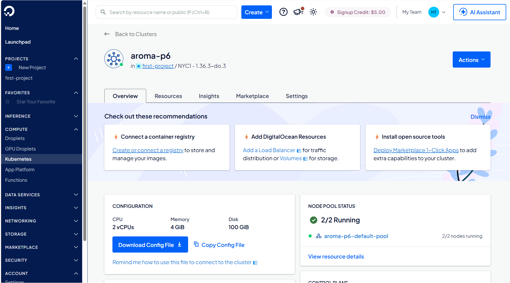
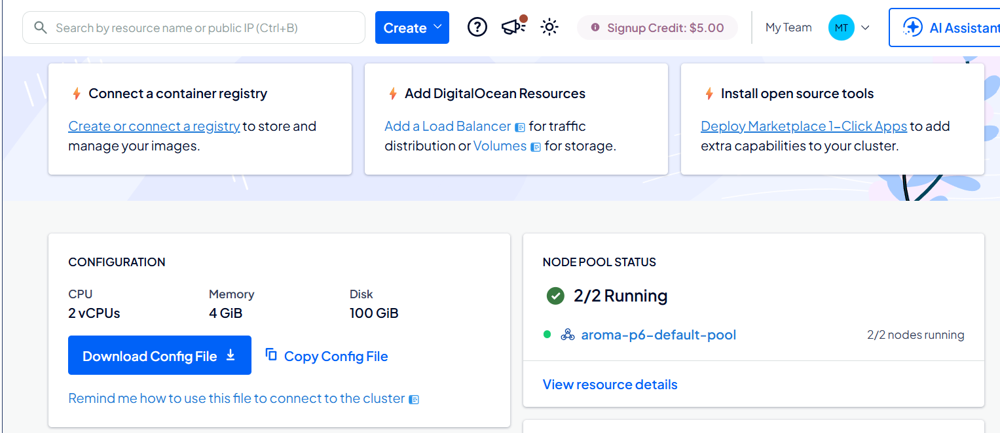
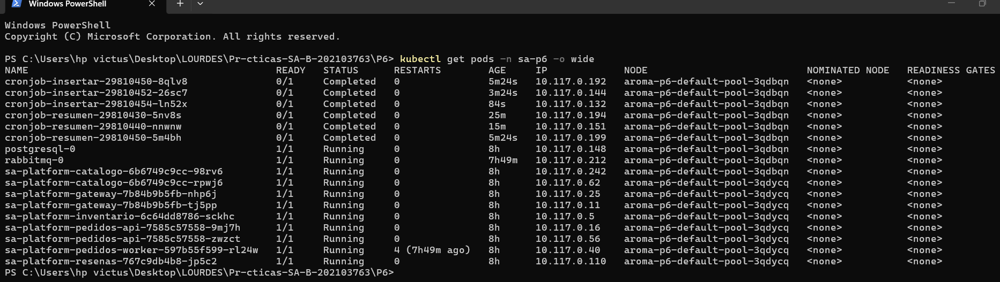
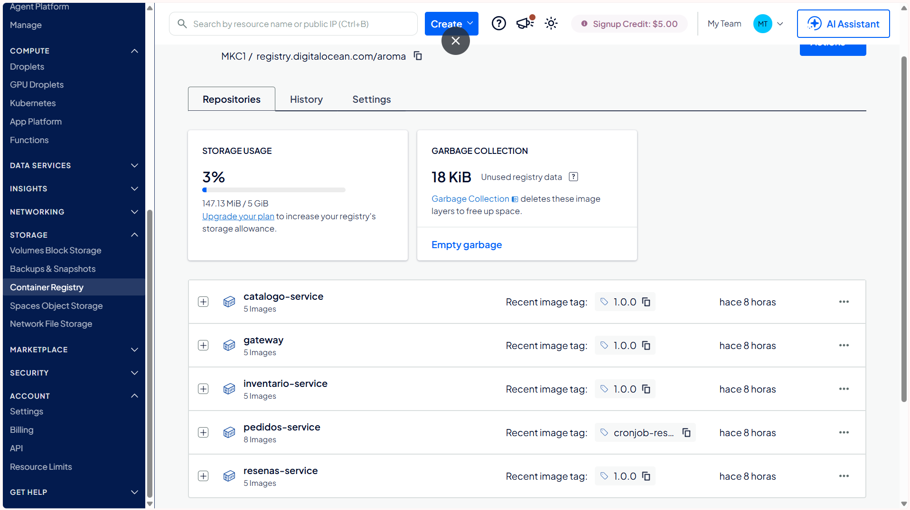
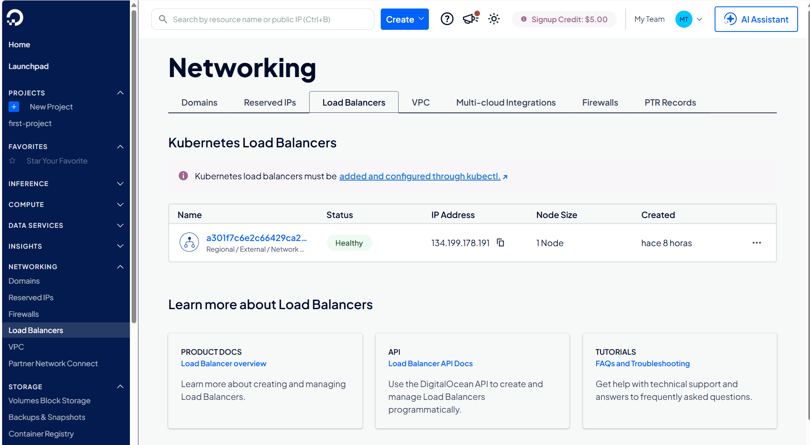
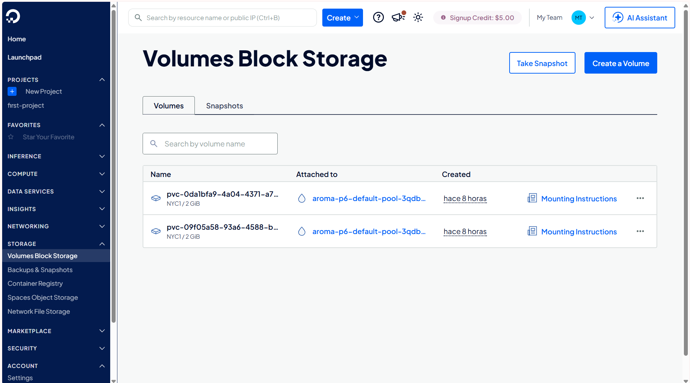
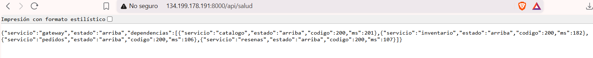
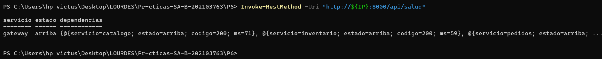

# Práctica 6 — Despliegue de la Plataforma Aroma en un Clúster de Kubernetes en la Nube

**Universidad de San Carlos de Guatemala**
**Facultad de Ingeniería · Escuela de Ciencias y Sistemas**
**Curso:** Software Avanzado — Segundo Semestre 2026
**Práctica 6:** Despliegue de la plataforma en un clúster de Kubernetes en la nube

| | |
|---|---|
| **Autor** | Jennifer Yulissa Lourdes Taperio Manuel |
| **Carné** | 202103763 |
| **Sección** | B |
| **Proveedor de nube utilizado** | DigitalOcean (DOKS + DOCR) |

---

## Índice

1. [Resumen](#1-resumen)
2. [Arquitectura y decisiones de diseño](#2-arquitectura-y-decisiones-de-diseño)
3. [Procedimiento completo de despliegue](#3-procedimiento-completo-de-despliegue)
4. [Dirección pública utilizada](#4-dirección-pública-utilizada)
5. [Evidencia de comunicación asíncrona gateway–microservicio](#5-evidencia-de-comunicación-asíncrona-gateway–microservicio)
6. [Evidencias de funcionamiento](#6-evidencias-de-funcionamiento)
7. [Costo aproximado del despliegue](#7-costo-aproximado-del-despliegue)
8. [Procedimiento de eliminación de recursos](#8-procedimiento-de-eliminación-de-recursos)
9. [Preguntas teóricas](#9-preguntas-teóricas)
10. [Conclusiones](#10-conclusiones)

---

## 1. Resumen

Este documento reúne toda la documentación de la Práctica 6: el procedimiento completo de despliegue, la dirección pública verificada, el costo aproximado generado, el procedimiento de eliminación de recursos y las respuestas a las cinco preguntas teóricas de la sección de alcances.

La plataforma desplegada es la construida en la Práctica 5 (chart de
Helm con cinco microservicios, PostgreSQL, RabbitMQ y comunicación
asíncrona), llevada sin reescribir su código a un clúster de Kubernetes
administrado real: **DigitalOcean Kubernetes (DOKS)**, con las imágenes
publicadas en **DigitalOcean Container Registry (DOCR)** y expuesta
mediante un `Service` de tipo `LoadBalancer` con dirección IP pública.

El objetivo del enunciado *llevar a un entorno real lo que ya está
construido* se cumple ya que no se modificó una sola línea de
lógica de negocio de los microservicios. Los únicos cambios sobre el
chart de la Práctica 5 fueron de configuración (una capa de valores
adicional para la nube) y una adición puntual para satisfacer el
requisito de comunicación asíncrona entre el *api gateway* y un
microservicio, detallada en la sección 2.

---

## 2. Arquitectura y decisiones de diseño

### 2.1 Por qué no se duplicó el código de la Práctica 5

El repositorio organiza esta práctica en una carpeta `P6` que **no
copia** el código fuente ni el chart de Helm de `P5`: los reutiliza
directamente por ruta relativa (`../P5/...`) en todos los comandos de
construcción e instalación. `P6` contiene únicamente lo que es
genuinamente nuevo para operar en la nube: un archivo de valores de
Helm (`values-do.yaml`), los scripts de construcción y publicación de
imágenes, y esta documentación. El chart que efectivamente se instala
es `../P5/charts/sa-platform` — el mismo `Chart.yaml`, los mismos seis
subcharts, las mismas `NetworkPolicy`, los mismos dos `CronJob`.

### 2.2 Qué cambió respecto a la Práctica 5

| Aspecto | Práctica 5 (minikube) | Práctica 6 (DigitalOcean) | Motivo |
|---|---|---|---|
| Registro de imágenes | Imágenes locales cargadas con `minikube image load` | DOCR (`registry.digitalocean.com/aroma/...`) | Los nodos de un clúster real no comparten el daemon de Docker de la máquina del desarrollador |
| Punto de entrada | `Ingress` con clase `nginx` | `Service` de tipo `LoadBalancer` | DOKS no trae un controlador de Ingress nativo; el enunciado ofrece el `Service LoadBalancer` como alternativa explícitamente válida |
| `type` del `Service` del gateway | Fijo en `ClusterIP` | Configurable (`ClusterIP` o `LoadBalancer`) | Se parametrizó el chart para admitir ambos proveedores sin bifurcar el código |
| Credenciales de imagen privada | No aplicaba (sin registro privado) | `imagePullSecrets` condicional en cada `ServiceAccount` | DOCR es privado; la integración automática de DigitalOcean solo actualiza el `ServiceAccount` *default*, y este chart usa cuentas de servicio propias por el requisito de mínimo privilegio de la Práctica 5 |
| `StorageClass` | La que trae minikube por defecto | `do-block-storage`, declarado explícitamente | Cumplir el requisito de usar la StorageClass propia del proveedor, no una heredada por accidente |
| Aplicación de `NetworkPolicy` | Dependía del addon de red de minikube | Automática, vía Cilium (CNI por defecto de DOKS) | Sin banderas adicionales al crear el clúster, a diferencia de otros proveedores |
| Credenciales del broker (`BROKER_URL`) | Vivían en el `ConfigMap` del subchart `pedidos` (en texto plano) | Movidas a `Secret` en `pedidos` y en el nuevo `Secret` del `gateway` | Esta práctica exige explícitamente credenciales gestionadas mediante `Secret`, no en texto plano |

Lo que **no cambió**: el código de los seis servicios, la estructura del
chart, las cinco `NetworkPolicy`, el RBAC de mínimo privilegio y el
flujo asíncrono productor/consumidor original entre `pedidos-api` y
`pedidos-worker`.

### 2.3 Adición nueva: comunicación asíncrona entre el gateway y un microservicio

El enunciado de esta práctica exige explícitamente *"comunicación
asíncrona entre microservicios y api gateway"*. El flujo heredado de la
Práctica 5 (`pedidos-api` → RabbitMQ → `pedidos-worker`) es asíncrono
entre dos microservicios, pero no involucra al *gateway* como
participante directo. Se agregó un segundo flujo para cerrar esa
brecha:

```text
gateway --publica--> [cola: gateway.auditoria] --consume--> pedidos-worker --guarda--> tabla auditoria_gateway
   |                                                                                          ↑
   └── responde al cliente HTTP de inmediato, SIN esperar a que la publicación termine ──────┘
```

Por cada petición que el *gateway* reenvía a un microservicio, publica
en paralelo —sin bloquear la respuesta— un evento de auditoría en
RabbitMQ. El mismo proceso consumidor que ya existía (`pedidos-worker`)
escucha ahora también esa cola y guarda cada evento en una tabla nueva.
Es, en sentido estricto, el *gateway* actuando como productor asíncrono
hacia un microservicio, que es la relación que la rúbrica pide
demostrar.

Este cambio, sobre el chart de la Práctica 5, implicó:

- Un cliente productor nuevo en el *gateway* (dependencia `amqplib`).
- Un `Secret` nuevo para el *gateway* (antes no necesitaba ninguno), ya
  que la credencial del broker no puede vivir en un `ConfigMap` de
  texto plano.
- La corrección del mismo problema en el subchart `pedidos`, donde la
  credencial del broker sí vivía en el `ConfigMap` desde la Práctica 5.
- La ampliación de la `NetworkPolicy` que protege a RabbitMQ, para
  admitir también al *gateway* como origen permitido.

---

## 3. Procedimiento completo de despliegue

Herramientas utilizadas: Docker, Git, `kubectl`, Helm 3, `doctl` (CLI de
DigitalOcean). Todos los comandos se ejecutaron en PowerShell sobre
Windows.

### Paso 1 — Instalación de `doctl` y autenticación

```powershell
winget install -e --id DigitalOcean.Doctl
doctl auth init
doctl account get
```

`doctl auth init` solicita un token de acceso personal, generado desde
el panel de control de DigitalOcean (*API → Tokens*).

### Paso 2 — Creación del clúster de Kubernetes administrado

```powershell
doctl kubernetes cluster create aroma-p6 `
  --region nyc1 `
  --size s-1vcpu-2gb `
  --count 2 `
  --wait
```

Al finalizar, `doctl` configura automáticamente el contexto de
`kubectl` contra el clúster nuevo. Se verificó con:

```powershell
kubectl get nodes
```

confirmando **dos nodos** en estado `Ready`. DOKS utiliza **Cilium**
como *Container Network Interface* por defecto, que aplica las
`NetworkPolicy` de Kubernetes sin necesidad de ninguna bandera adicional
en la creación del clúster.

### Paso 3 — Creación del registro de contenedores (DOCR)

```powershell
doctl registry create aroma --subscription-tier basic
doctl registry login
```

El plan `basic` incluye 5 GB de almacenamiento y un límite de **cinco
repositorios**. Como la plataforma tiene seis servicios propios, la
imagen `cronjob-resumen` se publicó como una *etiqueta* adicional dentro
del repositorio `pedidos-service` en lugar de crear un sexto
repositorio — el límite del plan es por nombre de repositorio, no por
la cantidad de etiquetas que contenga.

### Paso 4 — Construcción y publicación de las imágenes

```powershell
$registro = "registry.digitalocean.com/aroma"

docker build -t "$registro/gateway:1.0.0" ..\P5\services\gateway
docker push "$registro/gateway:1.0.0"

docker build -t "$registro/catalogo-service:1.0.0" ..\P5\services\catalogo-service
docker push "$registro/catalogo-service:1.0.0"

docker build -t "$registro/inventario-service:1.0.0" ..\P5\services\inventario-service
docker push "$registro/inventario-service:1.0.0"

docker build -t "$registro/pedidos-service:1.0.0" ..\P5\services\pedidos-service
docker push "$registro/pedidos-service:1.0.0"

docker build -t "$registro/resenas-service:1.0.0" ..\P5\services\resenas-service
docker push "$registro/resenas-service:1.0.0"

docker build -t "$registro/pedidos-service:cronjob-resumen-1.0.0" ..\P5\scripts\cronjob-resumen
docker push "$registro/pedidos-service:cronjob-resumen-1.0.0"
```

Verificación:

```powershell
doctl registry repository list-v2 aroma
```

Resultado esperado: cinco repositorios, con `pedidos-service` mostrando
dos etiquetas (`1.0.0` y `cronjob-resumen-1.0.0`).

### Paso 5 — Configuración del overlay de valores para la nube

El archivo `values-do.yaml` sobrescribe, sobre la base de
`values-dev.yaml` de la Práctica 5, únicamente lo que cambia por estar
en DigitalOcean: la ruta de las imágenes en DOCR, el `type` del
`Service` del *gateway* (`LoadBalancer`), el `StorageClass`
(`do-block-storage`) y el nombre del `Secret` de credenciales del
registro (`imagePullSecretName`).

### Paso 6 — Gestión de credenciales sin versionarlas

```powershell
Copy-Item values.example-cloud.yaml values-secretos-cloud.yaml
```

Las contraseñas reales de PostgreSQL y RabbitMQ se generaron con:

```powershell
python -c "import secrets; print(secrets.token_urlsafe(32))"
```

y se colocaron únicamente en `values-secretos-cloud.yaml`, archivo
excluido del control de versiones mediante `.gitignore`. El repositorio
solo versiona `values.example-cloud.yaml`, con valores ficticios.

### Paso 7 — Resolución de dependencias del chart

```powershell
helm repo add bitnami https://charts.bitnami.com/bitnami
helm repo update
helm dependency update ..\P5\charts\sa-platform\charts\gateway
helm dependency update ..\P5\charts\sa-platform\charts\catalogo
helm dependency update ..\P5\charts\sa-platform\charts\inventario
helm dependency update ..\P5\charts\sa-platform\charts\pedidos
helm dependency update ..\P5\charts\sa-platform\charts\resenas
helm dependency update ..\P5\charts\sa-platform
```

### Paso 8 — Validación del chart

```powershell
helm lint ..\P5\charts\sa-platform `
  -f ..\P5\charts\sa-platform\values-dev.yaml `
  -f values-do.yaml `
  -f values-secretos-cloud.yaml
```

### Paso 9 — Instalación en el clúster de la nube

```powershell
helm install sa-platform ..\P5\charts\sa-platform `
  -f ..\P5\charts\sa-platform\values-dev.yaml `
  -f values-do.yaml `
  -f values-secretos-cloud.yaml `
  --namespace sa-p6 --create-namespace
```

El espacio de nombres `sa-p6` lo crea el propio comando de instalación,
no un paso manual independiente.

### Paso 10 — Conexión del registro privado al espacio de nombres

```powershell
(doctl registry kubernetes-manifest) -replace 'namespace: kube-system', 'namespace: sa-p6' | kubectl apply -f -
```

El manifiesto que genera `doctl registry kubernetes-manifest` trae
`namespace: kube-system` escrito de forma fija; se reescribe esa línea
antes de aplicar, porque `kubectl` no permite que la bandera `-n`
contradiga un espacio de nombres ya declarado en el propio manifiesto.
Esto crea el `Secret` de credenciales (`registry-aroma`) que los
`ServiceAccount` del chart referencian para poder descargar las
imágenes privadas.

### Paso 11 — Obtención de la dirección pública

```powershell
kubectl get svc -n sa-p6 sa-platform-gateway -w
```

Cuando la columna `EXTERNAL-IP` deja de mostrar `<pending>`, DigitalOcean
ya aprovisionó el *Load Balancer* con una IP pública real (ver
sección 4).

### Incidencias resueltas durante el despliegue

Dos ajustes se hicieron sobre la marcha, y quedan documentados aquí
porque son parte legítima del procedimiento reproducible:

1. **Capacidad insuficiente con un solo nodo.** Al crear el clúster con
   un único nodo, un segundo Pod del microservicio de catálogo quedó
   indefinidamente en estado `Pending`. Se escaló el *node pool* a dos
   nodos con `doctl kubernetes cluster node-pool update aroma-p6
   aroma-p6-default-pool --count 2`.
2. **Sincronización del firewall administrado.** El firewall que DOKS
   administra automáticamente no sincronizó a tiempo el puerto interno
   (`NodePort`) real del `Service`, bloqueando en silencio el tráfico
   del *Load Balancer* hacia los nodos. Se abrió manualmente con
   `doctl compute firewall add-rules <firewall-id> --inbound-rules
   "protocol:tcp,ports:<nodeport>,address:0.0.0.0/0"`. El detalle
   completo de cómo se diagnosticó esta capa está en la pregunta
  teórica 2 (sección 9).

---

## 4. Dirección pública utilizada

```powershell
$IP = kubectl get svc -n sa-p6 sa-platform-gateway -o jsonpath='{.status.loadBalancer.ingress[0].ip}'
```

**Dirección IP pública verificada durante el desarrollo de esta
práctica:** `http://134.199.178.191:8000`

> **Nota importante sobre el puerto.** El `Service` del *gateway*
> expone el puerto **8000**, no el 80 que asume `http://` por defecto.
> Toda petición contra esta dirección requiere el puerto explícito.

Verificación realizada:

```powershell
Invoke-RestMethod -Uri "http://134.199.178.191:8000/api/salud"
```

Respuesta obtenida:

```json
{
  "servicio": "gateway",
  "estado": "arriba",
  "dependencias": [
    { "servicio": "catalogo",    "estado": "arriba", "codigo": 200 },
    { "servicio": "inventario",  "estado": "arriba", "codigo": 200 },
    { "servicio": "pedidos",     "estado": "arriba", "codigo": 200 },
    { "servicio": "resenas",     "estado": "arriba", "codigo": 200 }
  ]
}
```

> **Si el clúster fue recreado después de esta verificación**, la IP
> pública cambia (DigitalOcean no garantiza IPs estáticas para un
> *Load Balancer* nuevo). Actualizar este valor con el resultado real de
> `kubectl get svc -n sa-p6 sa-platform-gateway` antes de la entrega
> final si el clúster de calificación es distinto al usado durante el
> desarrollo.

---

## 5. Evidencia de comunicación asíncrona gateway–microservicio

### 5.1 El gateway como productor (flujo nuevo de esta práctica)

```powershell
Invoke-RestMethod -Uri "http://134.199.178.191:8000/api/catalogo/graphql" -Method Post `
  -ContentType "application/json" -Body '{"query":"{ productos { id } }"}'

kubectl exec -n sa-p6 postgresql-0 -- env PGPASSWORD='<clave-real>' psql -U aroma -d pedidos_db `
  -c "SELECT metodo, ruta, publicado_en FROM auditoria_gateway ORDER BY id DESC LIMIT 5;"
```

Resultado obtenido:

```text
 metodo |         ruta          |        publicado_en
--------+-----------------------+----------------------------
 POST   | /api/catalogo/graphql | 2026-09-05 09:18:54.519+00
 POST   | /api/catalogo/graphql | 2026-09-05 09:17:42.779+00
 GET    | /api/salud            | 2026-09-05 09:14:42.862+00
 GET    | /api/salud            | 2026-09-05 09:13:23.051+00
```

Cada fila corresponde a una petición real hecha contra la IP pública:
el *gateway* la publicó en RabbitMQ sin esperar respuesta, y
`pedidos-worker` la consumió de forma independiente y la persistió.

### 5.2 El flujo heredado de la Práctica 5, con el consumidor caído

```powershell
kubectl scale deployment/sa-platform-pedidos-worker -n sa-p6 --replicas=0

Invoke-RestMethod -Uri "http://134.199.178.191:8000/api/pedidos" -Method Post `
  -ContentType "application/json" -Body '{"items":[{"productoId":"1","cantidad":1}]}'

kubectl scale deployment/sa-platform-pedidos-worker -n sa-p6 --replicas=1
Start-Sleep -Seconds 15
kubectl logs -n sa-p6 deployment/sa-platform-pedidos-worker --tail=10
```

El pedido se crea correctamente aunque el consumidor esté apagado
(confirmando que el productor nunca espera al consumidor); al
reactivarlo, el registro del proceso muestra la notificación procesada
sin pérdida de información.

---

## 6. Evidencias de funcionamiento

### 6.1 Adaptación a la nube: almacenamiento, red y secretos

**Almacenamiento — `StorageClass` del proveedor:**

```powershell
kubectl get pvc -n sa-p6 -o jsonpath='{.items[*].spec.storageClassName}'
```

Resultado: `do-block-storage do-block-storage` — confirmado para los
volúmenes de PostgreSQL y RabbitMQ.

**Secretos — credenciales fuera del repositorio:**

```powershell
$valor = kubectl get secret sa-platform-catalogo -n sa-p6 -o jsonpath='{.data.DATABASE_URL}'
[System.Text.Encoding]::UTF8.GetString([System.Convert]::FromBase64String($valor))
```

Este comando confirma que la cadena de conexión (con la contraseña
real) vive únicamente dentro de un objeto `Secret` de Kubernetes,
gestionado por Helm, y que nunca estuvo escrita en ningún archivo
versionado del repositorio.

**Red — `NetworkPolicy` bloqueando tráfico no autorizado:**

```powershell
kubectl run sonda --image=busybox:1.36 -n sa-p6 --rm -it --restart=Never -- `
  wget -qO- --timeout=5 http://sa-platform-catalogo:4001/salud
```

Esta prueba, ejecutada desde un Pod sin la etiqueta del *gateway*, debe
fallar por tiempo de espera agotado — confirmando que el aislamiento de
red heredado de la Práctica 5 sigue vigente en el clúster de la nube.

### 6.2 Evidencia

Las siguientes evidencias visuales se anexan como archivos de imagen en
la carpeta `docs/screen/`.

**01 — Clúster, pestaña Overview.**
Consola de DigitalOcean → *Kubernetes* → `aroma-p6` → pestaña
*Overview*: nombre del clúster, región, versión de Kubernetes y estado
`Running`.





**02 — Clúster, nodos.**
Misma pantalla, sección/pestaña de nodos: deben aparecer los **2 nodos**
`s-1vcpu-2gb` en estado saludable.



> La consola web de DigitalOcean no incluye una vista tipo "Workloads"
> que liste los Pods individualmente — eso se obtiene por `kubectl` no por la consola.

**03 — Pods en ejecución (terminal).**

```powershell
kubectl get pods -n sa-p6 -o wide
```

Captura de la terminal completa, mostrando los 8 pods de la plataforma
(`postgresql-0`, `rabbitmq-0`, `gateway`, `catalogo`, `inventario`,
`pedidos-api`, `pedidos-worker`, `resenas`) en `1/1 Running`, repartidos
entre los 2 nodos. **Este es el elemento que el enunciado pide por
nombre explícito** ("screen... de los pods en ejecución").





**04 — Container Registry.**
Consola → *Container Registry* → `aroma`: los cinco repositorios
publicados (`gateway`, `catalogo-service`, `inventario-service`,
`pedidos-service`, `resenas-service`), con `pedidos-service` mostrando
sus dos etiquetas.




**05 — Load Balancer.**
Consola → *Networking → Load Balancers*: el balanceador creado
automáticamente por el `Service` del *gateway*, con su IP pública
visible.





**06 — Volumes.**
Consola → *Volumes*: los dos discos persistentes (PostgreSQL y
RabbitMQ) con el tamaño y la región correctos.




**07 — Petición exitosa desde internet.**
Navegador visitando `http://<IP>:8000/api/salud` con la **barra de
direcciones visible** (confirma que no es `localhost`), o la salida de
`Invoke-RestMethod -Uri "http://<IP>:8000/api/salud"` en terminal.
Idealmente, una segunda captura de la misma petición hecha **desde
datos móviles** (wifi apagado), como evidencia reforzada de acceso
público real. **Este es el segundo elemento que el enunciado pide por
nombre explícito** ("peticiones realizadas desde internet a la
dirección pública").



---


## 7. Costo aproximado del despliegue

Los recursos de este despliegue se facturan por el tiempo que existen,
no por el tráfico que reciben. La siguiente tabla refleja el tamaño de
clúster **realmente utilizado**.

| Recurso | Cantidad | Costo aproximado |
|---|---|---|
| Nodo `s-1vcpu-2gb` (1 vCPU, 2 GB) | 2 | ≈ USD 0.009/hora c/u → ≈ USD 0.018/hora total |
| Plano de control de DOKS | 1 | Gratuito (a diferencia de otros proveedores) |
| Volumen persistente (PostgreSQL 2 GiB + RabbitMQ 2 GiB) | 2 | ≈ USD 0.10/GiB-mes |
| *Load Balancer* (creado por el `Service` del *gateway*) | 1 | ≈ USD 0.017/hora (≈ USD 12/mes) |
| Container Registry (DOCR, plan `basic`) | 1 | ≈ USD 5/mes fijos |

**Total aproximado mientras el clúster permanece activo:** entre USD
0.04 y 0.05 por hora, más los cargos fijos mensuales del registro
(≈ USD 5) y del *Load Balancer* si se factura por hora completa
(≈ USD 12/mes). El nodo es, en proporción, el rubro más económico de
los cuatro; el *Load Balancer* y el registro pesan más en un despliegue
de este tamaño.

DigitalOcean no cobra por el plano de control del clúster, a diferencia
de otros proveedores administrados — una diferencia de costo relevante
para un despliegue de duración acotada como el de esta práctica.

### 7.1 Ajuste real de dimensionamiento

Al crear el clúster con un solo nodo (para minimizar costo de entrada),
la plataforma completa no cabía: un Pod adicional quedó indefinidamente
en estado `Pending`. Fue necesario escalar a dos nodos. La lección de
costos es directa: el requisito de "al menos dos nodos" no es un
formalismo de la rúbrica — por debajo de ese mínimo, el sistema
sencillamente no funciona, y "ahorrar" con un solo nodo solo desplaza el
problema de "más caro" a "no funcional".

### 7.2 Formas de reducir el costo

- Mantener el tamaño de nodo más pequeño que sostenga la carga
  (`s-1vcpu-2gb` x 2 ya es el piso viable para este sistema).
- Reducir el tamaño de los volúmenes persistentes si no se requiere
  generar grandes volúmenes de datos de prueba.
- Usar el plan `starter` del registro si las imágenes propias caben en
  su límite de almacenamiento más reducido (en este proyecto no fue
  suficiente, y se requirió el plan `basic`).
- No mantener el clúster activo fuera de las horas de evaluación —
  motivo directo del procedimiento de la sección 8.
- Verificar la disponibilidad de créditos de bienvenida o educativos
  de la plataforma antes de iniciar.

---

## 8. Procedimiento de eliminación de recursos

El orden importa: primero los recursos **dentro** del clúster, para que
Kubernetes le indique a DigitalOcean que debe liberar el *Load
Balancer* de forma ordenada, y al final el clúster y el registro.

```powershell
# 1. Desinstalar el release de Helm (elimina Deployments y Services,
#    lo que a su vez libera el Load Balancer asociado)
helm uninstall sa-platform -n sa-p6

# 2. Confirmar que el Load Balancer se liberó (puede tardar 1-2 minutos)
kubectl get svc -n sa-p6

# 3. Eliminar el espacio de nombres, por si quedó algún objeto suelto
kubectl delete namespace sa-p6

# 4. Eliminar el clúster de DOKS completo (nodos + plano de control).
#    Esto también elimina el firewall administrado automáticamente por
#    DOKS, incluida la regla manual del NodePort agregada durante el
#    despliegue (ver sección 3, "Incidencias resueltas").
doctl kubernetes cluster delete aroma-p6 --force

# 5. Eliminar el registro de contenedores
doctl registry delete aroma --force

# 6. Verificar que no quede ningún volumen huérfano
doctl compute volume list

# 7. Verificar que no quede ningún firewall huérfano
doctl compute firewall list
```

**Confirmación de limpieza completa:** en la consola web de
DigitalOcean, la sección *Kubernetes* debe quedar vacía, *Container
Registry* no debe mostrar el registro `aroma`, *Volumes* no debe listar
ningún disco relacionado con `postgresql` o `rabbitmq`, y *Networking →
Firewalls* no debe mostrar ningún firewall asociado al clúster
eliminado. Estas cuatro pantallas, capturadas tras la ejecución del
procedimiento anterior, constituyen la evidencia de eliminación de
recursos que exige el entregable.

> **Nota sobre reglas de firewall manuales.** La regla abierta a mano
> durante el despliegue (sección 3) no genera costo adicional, pero
> tampoco tiene utilidad si se recrea el clúster más adelante: el
> `NodePort` de un clúster nuevo será distinto, y la regla habrá que
> volver a crearla. Se elimina automáticamente al borrar el clúster
> (paso 4 de este procedimiento), por lo que no requiere una acción de
> limpieza independiente.

---

## 9. Preguntas teóricas

### 9.1 ¿Qué es un clúster de Kubernetes administrado y qué diferencias tiene frente a uno local?

Un clúster administrado es aquel en el que el proveedor de nube opera
el plano de control —el servidor de API, `etcd`, el planificador y el
controlador de gestión— como un servicio propio: no corre en una
máquina que el estudiante deba administrar, no requiere parches ni
respaldos de su parte, y está disponible con alta disponibilidad desde
el primer minuto. En DOKS concretamente, ni siquiera es visible un
nodo para el plano de control: `kubectl get nodes` únicamente muestra
los nodos *worker*, que sí son responsabilidad del estudiante y los
únicos que se facturan.

Las diferencias frente a un clúster local (minikube, usado en la
Práctica 5) resultaron evidentes durante este despliegue:

- **Persistencia real.** minikube simulaba el `StorageClass` con
  almacenamiento del disco del equipo local; en DOKS,
  `do-block-storage` aprovisiona un volumen de red real, con ciclo de
  vida independiente del nodo que lo utiliza.
- **Balanceo de carga real.** minikube requería `minikube tunnel` para
  simular una dirección externa. En DOKS, un `Service` de tipo
  `LoadBalancer` provisiona un balanceador real de DigitalOcean con IP
  pública, sin ningún proceso corriendo en el equipo del desarrollador.
- **Múltiples nodos reales.** minikube ejecuta un único nodo dentro de
  un contenedor Docker. En este despliegue existen dos servidores
  (*Droplets*) distintos, entre los que el planificador de Kubernetes
  distribuye los Pods.
- **Red con reglas reales.** minikube no exigía ninguna configuración
  adicional para que las políticas de red funcionaran. DOKS incorpora
  Cilium como interfaz de red por defecto, que las aplica de fábrica.
- **Costo.** Un clúster local no genera más costo que el consumo de
  recursos del propio equipo. Un clúster administrado factura por cada
  nodo, cada volumen y el balanceador mientras existan, sin importar si
  reciben tráfico — aunque DigitalOcean, a diferencia de otros
  proveedores, no factura el plano de control por separado.

### 9.2 ¿Qué es un Service de tipo LoadBalancer y cómo lo implementa el proveedor de nube?

Un `Service` de tipo `LoadBalancer` solicita a Kubernetes que exponga
ese servicio con una dirección accesible desde fuera del clúster.
Kubernetes, por sí mismo, no puede crear esa dirección: delega esa
tarea al *cloud controller manager*, el componente que conecta el
clúster con la API propia de cada proveedor. En DigitalOcean, crear un
`Service` de este tipo desencadena la creación de un balanceador de
carga real: una dirección IP pública reservada, con reglas de reenvío
hacia los nodos que ejecutan los Pods del servicio seleccionado (a
través de un puerto interno del nodo, o *NodePort*).

Esta práctica utilizó directamente un `Service LoadBalancer` para el
*gateway* —en lugar de un `Ingress`, como se había planteado
inicialmente pensando en un proveedor distinto— porque DOKS no incluye
un controlador de Ingress nativo tan inmediato como el de otros
proveedores: instalar uno adicional era posible, pero agregaba una
pieza más al despliegue sin necesidad, cuando el propio enunciado
ofrece el `Service LoadBalancer` como alternativa explícitamente
válida. La diferencia práctica es que un `Ingress` puede enrutar por
ruta o por nombre de dominio hacia varios servicios con una sola
dirección IP, mientras que un `Service LoadBalancer` reserva una
dirección por cada servicio que lo utilice; para un sistema con un
único punto de entrada —el *gateway*— esa capacidad adicional de
enrutamiento no era necesaria.

**Lo que la teoría no deja ver hasta que falla en la práctica.** El
mecanismo de reenvío hacia los nodos mediante un puerto interno no es
un detalle abstracto: durante este despliegue, el `Service LoadBalancer`
obtuvo su dirección pública sin ningún error, pero las peticiones
seguían agotando el tiempo de espera. El diagnóstico terminó revelando
tres capas distintas que deben entenderse por separado al operar un
balanceador de carga real:

1. **El propio `Service`.** `kubectl get endpoints` confirmó que sí
   tenía Pods sanos como destino.
2. **El firewall administrado por el proveedor.** El firewall que DOKS
   gestiona automáticamente no había sincronizado el puerto interno
   real del servicio (generado de forma dinámica, distinto del puerto
   público del `Service`), y las peticiones se descartaban en silencio
   antes de llegar al nodo. Se confirmó probando directamente contra
   la dirección de un nodo en ambos puertos, comparando el tiempo de
   espera agotado (firewall bloqueando) contra una conexión rechazada
   (firewall permitiendo el paso, pero sin nada escuchando en ese
   puerto específico).
3. **La omisión del puerto en la dirección.** El `Service` del
   *gateway* utiliza el puerto 8000, no el 80 que asume el protocolo
   HTTP por defecto; una vez resuelto el firewall, las primeras
   pruebas seguían fallando simplemente por no incluir el puerto en la
   dirección.

La lección no se limita a "revisar el firewall": un `Service
LoadBalancer` real involucra al menos tres capas independientes —
Kubernetes, el firewall administrado del proveedor y el puerto correcto
del lado del cliente— y cada una falla de forma distinta. Ninguna de
estas capas es visible en un clúster local como minikube, que no posee
firewall de proveedor ni un puerto interno real que deba sincronizarse.

### 9.3 ¿Qué es un registro de contenedores y por qué es necesario para desplegar en la nube?

Un registro de contenedores es un servidor que almacena imágenes Docker
identificadas por nombre y etiqueta, consultable por cualquier motor de
contenedores compatible. Resulta necesario porque los nodos de un
clúster en la nube son máquinas distintas a aquella donde el
desarrollador construye las imágenes: en minikube, la construcción y el
componente que ejecuta los Pods comparten el mismo daemon de Docker, lo
que permite cargar imágenes directamente; en un clúster real, los nodos
nunca tuvieron acceso a ese proceso de construcción y no tienen forma
de obtener la imagen a menos que exista en un lugar accesible por red.

Se utilizó DOCR (DigitalOcean Container Registry) por ser el registro
nativo del mismo proveedor del clúster, con una integración
deliberadamente simple: un solo comando configura las credenciales de
Docker, y otro genera el objeto `Secret` de credenciales que el clúster
necesita para poder descargar imágenes de un registro privado —a
diferencia de un registro público sin autenticación, donde ese paso no
sería necesario, pero tampoco existiría control sobre quién puede leer
las imágenes.

### 9.4 ¿Qué componentes del clúster administra el proveedor y cuáles siguen siendo responsabilidad del estudiante?

| Administra DigitalOcean (DOKS) | Sigue siendo responsabilidad del estudiante |
|---|---|
| El plano de control (servidor de API, `etcd`, planificador, controlador) | Los manifiestos y el chart de la aplicación, y su correcta configuración |
| Los parches de seguridad del plano de control | El sistema operativo y los parches de los nodos |
| La alta disponibilidad del servidor de API | El dimensionamiento de los nodos (tamaño y cantidad) |
| La interfaz de red (Cilium) y la aplicación efectiva de las políticas de red | El contenido de esas políticas: qué reglas escribir y verificar que cumplan su propósito |
| El aprovisionamiento del balanceador de carga al crear el `Service` | Las credenciales de la aplicación: su contenido y que no queden versionadas |
| El aprovisionamiento del volumen al crear el `PersistentVolumeClaim` | El costo: ningún recurso se detiene por sí solo; su eliminación es manual |
| El firewall base que habilita el puerto del `Service` al crear el balanceador | Verificar que ese firewall administrado quedó correctamente sincronizado — en este despliegue no sincronizó a tiempo el puerto interno real, y fue necesario abrirlo manualmente |

La línea general es que el proveedor administra la infraestructura de
Kubernetes en sí; todo lo que define qué se ejecuta y cómo está
configurado sigue siendo responsabilidad del chart de Helm y de las
decisiones documentadas en este repositorio. Como ilustra la última
fila de la tabla, que un componente esté "administrado por el
proveedor" no significa que esté exento de intervención: en ocasiones
la automatización falla, y es necesario saber diagnosticar en qué capa
exacta ocurrió el fallo.

### 9.5 ¿Qué costos genera el despliegue realizado y cómo podrían reducirse?

El desglose completo está en la sección 7 de este documento. En
síntesis, tres rubros generan costo mientras el clúster permanece
activo: el cómputo (los dos nodos, facturados por hora
independientemente del tráfico recibido, sin que el plano de control
genere cargo adicional en este proveedor), el almacenamiento (los
volúmenes de PostgreSQL y RabbitMQ, facturados por espacio y tiempo aun
si el Pod que los utilizaba ya fue eliminado, dado que el volumen
sobrevive por diseño) y la red (el balanceador de carga, facturado por
hora de existencia sin importar el tráfico que reciba).

Las formas concretas de reducir el costo, aplicadas o consideradas en
este despliegue, se detallan en la sección 7.2: mantener el tamaño de
nodo mínimo viable, ajustar el tamaño de los volúmenes al uso real,
seleccionar el plan de registro más económico que sea suficiente, y
—la medida de mayor impacto— no mantener el clúster activo fuera de las
horas de evaluación, siguiendo el procedimiento de eliminación descrito
en la sección 8.

---

## 10. Conclusiones

El despliegue demostró que el mismo artefacto construido en la Práctica
5 —un chart de Helm autocontenido, con su propia gestión de
configuración, secretos, persistencia, red y comunicación asíncrona— es
portable entre un clúster local y uno administrado en la nube, y entre
proveedores de nube distintos, con una única capa adicional de valores.
Este es, precisamente, el problema que Helm está diseñado para
resolver.

Las incidencias reales encontradas durante el proceso —la necesidad de
escalar el número de nodos, la sincronización incompleta del firewall
administrado, y el hábito de omitir el puerto en la dirección pública—
no fueron obstáculos accesorios: son exactamente el tipo de diferencia
entre un entorno de desarrollo local y uno productivo que esta práctica
buscaba hacer evidente, y quedaron documentadas como parte legítima del
procedimiento, no ocultadas en una narrativa idealizada del despliegue.
