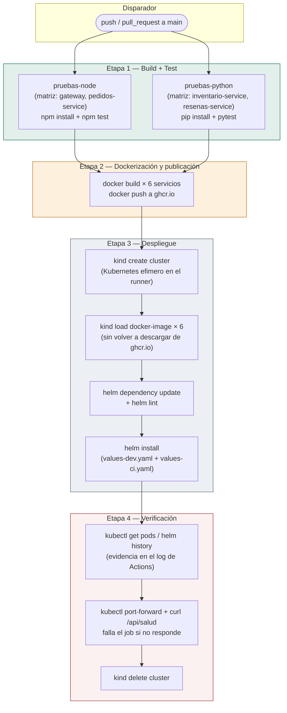

# Práctica 7 — Integración y Despliegue Continuo (CI/CD)

**Universidad de San Carlos de Guatemala**
**Facultad de Ingeniería · Escuela de Ciencias y Sistemas**
**Curso:** Software Avanzado — Segundo Semestre 2026

| | |
|---|---|
| **Autor** | Jennifer Yulissa Lourdes Taperio Manuel |
| **Carné** | 202103763 |
| **Sección** | B |
| **Workflow** | [`.github/workflows/ci-cd.yml`](../.github/workflows/ci-cd.yml) |

---

## Índice

1. [Alcance confirmado con el auxiliar del curso](#1-alcance-confirmado-con-el-auxiliar-del-curso)
2. [Cumplimiento de requisitos](#2-cumplimiento-de-requisitos)
3. [Diagrama del pipeline](#3-diagrama-del-pipeline)
4. [Explicación del flujo, etapa por etapa](#4-explicación-del-flujo-etapa-por-etapa)
5. [Pruebas automáticas agregadas](#5-pruebas-automáticas-agregadas)
6. [Cómo verificar una corrida](#6-cómo-verificar-una-corrida)
7. [Preguntas teóricas](#7-preguntas-teóricas)
8. [Conclusiones](#8-conclusiones)

---

## 1. Alcance confirmado con el auxiliar del curso

Dos decisiones de esta entrega no están en el enunciado de forma
literal y se confirmaron directamente con el auxiliar antes de
construir el pipeline, para que quede documentado por qué se hicieron
así y no de otra forma:

**El despliegue es local (efímero), no a un clúster de nube real.**
El propio enunciado sugiere "Despliegue automático usando k8s" sin
especificar dónde debe vivir ese clúster. Reutilizar el clúster de
DigitalOcean de la Práctica 6 habría exigido guardar credenciales de
larga duración como *secrets* del repositorio — un riesgo real para
un repositorio de práctica — y además el clúster de la Práctica 6 ya
fue eliminado al finalizar esa entrega (ver su documentación de
limpieza). La alternativa usada aquí, confirmada con el auxiliar:

> *"mi pipeline crea un clúster de Kubernetes efímero dentro del
> propio runner de GitHub Actions con kind, despliega ahí con Helm y
> verifica que responda."* — y su respuesta: *"Lo único que requiero
> es se ejecute el pipeline y se corran los tests y que se vea
> reflejado en la corrida del pipeline en GitHub Actions."*

Esto es lo que implementa este pipeline: cada corrida crea un clúster
de Kubernetes real (con [kind](https://kind.sigs.k8s.io/), *Kubernetes
IN Docker*) dentro del propio runner, instala ahí la plataforma
completa con el mismo chart de Helm de las Prácticas 5 y 6, verifica
que responda, y lo destruye al terminar. Es un clúster real —no un
simulacro ni un mock—, solo que vive únicamente durante los minutos
que dura la corrida, en vez de persistir en una cuenta de nube.

**Ubicación de los archivos.** El enunciado pide dejar el código del
pipeline en la carpeta `/P7`, pero GitHub Actions solo descubre
workflows dentro de `.github/workflows/` — es un requisito técnico de
la plataforma, no una elección de diseño. Se consultó al auxiliar,
quien respondió: *"deja la carpeta donde se te sea más cómodo."* En
consecuencia: el archivo del workflow vive en
`.github/workflows/ci-cd.yml` (donde GitHub lo exige para que
funcione), y `P7/` contiene todo lo demás que pide el enunciado —
esta documentación, el diagrama y `values-ci.yaml`.

---

## 2. Cumplimiento de requisitos

| Requisito del enunciado | Dónde se implementa |
|---|---|
| Pipeline CI configurado en GitHub Actions | `.github/workflows/ci-cd.yml` |
| Automatización de build del proyecto | Jobs `pruebas-node` / `pruebas-python` (instalan dependencias) + build de las 6 imágenes Docker |
| Ejecución de pruebas automáticas | Jobs `pruebas-node` (Node, 4 servicios × pruebas nuevas) y `pruebas-python` (pytest, 2 servicios × pruebas nuevas) — ver sección 5 |
| Construcción automática de imágenes Docker | Job `build-publicar-desplegar`, paso "Construir y publicar las 6 imágenes" |
| Push de imágenes a un registry | GitHub Container Registry (`ghcr.io`), usando el `GITHUB_TOKEN` que GitHub ya provee — sin secretos adicionales que configurar |
| Despliegue automático usando k8s | Clúster efímero con `kind` dentro del mismo job, instalado con Helm |
| Uso del sistema de microservicios de la práctica anterior | El mismo chart de `P5/charts/sa-platform`, sin reescribir código, igual que en la Práctica 6 |
| Documentación técnica | Este documento |
| Diagrama del pipeline | Sección 3 |
| Organización del repositorio | `/P7` (documentación) + `.github/workflows/` (el workflow), según lo confirmado con el auxiliar |
| Preguntas teóricas | Sección 7 |

---

## 3. Diagrama del pipeline

Las cuatro etapas que exige el requisito 2.1 de la rúbrica ("al menos
4 etapas: build, test, dockerización y despliegue") están, en orden,
en los recuadros de arriba: **build** ocurre implícito dentro de cada
job de pruebas (instalar dependencias) y explícito en el `docker
build`; **test** son los dos jobs con matriz; **dockerización** es la
etapa 2 completa; **despliegue** es la etapa 3. La etapa 4
(verificación) no la exige la rúbrica de forma literal, pero es la
que convierte "el pipeline terminó sin errores" en "el sistema
realmente responde" — sin ella, un despliegue roto podría pasar
desapercibido con un `helm install` que técnicamente tuvo éxito pero
dejó pods sin poder comunicarse entre sí.

---

## 4. Explicación del flujo, etapa por etapa

### 4.1 Disparador

El workflow corre en cada `push` a `main`, en cada `pull_request`
contra `main`, y manualmente con `workflow_dispatch` (útil para
volver a correrlo sin necesidad de un commit nuevo, por ejemplo al
preparar la evidencia para calificación).

### 4.2 Pruebas (jobs `pruebas-node` y `pruebas-python`)

Corren **en paralelo**, cada uno con una matriz de dos servicios, para
que un fallo en un servicio no oculte el resultado de los demás en el
resumen del pipeline. `pruebas-node` instala las dependencias de
`gateway` y `pedidos-service` con `npm install` y corre `npm test`
(el ejecutor de pruebas incluido en Node.js, sin dependencias
adicionales). `pruebas-python` instala `inventario-service` y
`resenas-service` (dependencias de producción + `pytest`) y corre
`python -m pytest`. El job de construcción y despliegue depende
explícitamente de que ambos terminen bien (`needs: [pruebas-node,
pruebas-python]`): si una sola prueba falla, el pipeline se detiene
ahí y nunca llega a construir ni publicar imágenes.

### 4.3 Construcción y publicación de imágenes

Un solo paso de *shell* construye y publica las 6 imágenes (los cinco
microservicios más `cronjob-resumen`, heredado de la Práctica 5/6),
etiquetadas con los primeros 12 caracteres del SHA del commit — así
cada corrida deja una imagen identificable y nunca sobrescribe
silenciosamente la anterior. Se publican en **GitHub Container
Registry** (`ghcr.io`) porque el propio `GITHUB_TOKEN` que GitHub
inyecta automáticamente en cada corrida ya tiene permiso de escritura
sobre los paquetes del repositorio — no hace falta que el estudiante
cree ni gestione ninguna cuenta ni credencial adicional, a diferencia
de DockerHub.

### 4.4 Despliegue en el clúster efímero

`kind` crea un clúster de Kubernetes real dentro de un contenedor
Docker del propio runner. Las 6 imágenes ya construidas se cargan
directamente en ese clúster con `kind load docker-image`, sin volver
a descargarlas de `ghcr.io` — más rápido, y evita tener que configurar
un `Secret` de credenciales de registro dentro de un clúster que va a
existir solo un par de minutos. Después se resuelven las dependencias
del chart (Bitnami PostgreSQL/RabbitMQ + la librería compartida
`sa-common`, igual que en las Prácticas 5 y 6) y se instala con
`helm install`, combinando `values-dev.yaml` (la base) con
`P7/values-ci.yaml` (el overlay para un runner compartido: una
réplica por servicio, sin HPA, sin Ingress) y `--set` para las 6
rutas de imagen, que solo se conocen en tiempo de ejecución porque
dependen del nombre del repositorio de GitHub.

### 4.5 Verificación

`helm install --wait` ya obliga a que todos los `Deployment` y el
`StatefulSet` de Postgres/RabbitMQ estén listos antes de continuar,
pero eso confirma que los *procesos arrancaron*, no que el *sistema
funcione*. El paso final hace un `kubectl port-forward` hacia el
gateway y le pega una petición real a `/api/salud`: si el JSON no
contiene `"estado":"arriba"`, el paso falla explícitamente
(`exit 1`), lo que marca todo el pipeline como fallido en la interfaz
de Actions — es la comprobación de extremo a extremo, no solo de que
Kubernetes reporte los pods como listos.

### 4.6 Limpieza

El último paso (`if: always()`) destruye el clúster de kind sin
importar si los pasos anteriores tuvieron éxito o no, para que el
runner (que de todos modos se destruye al terminar el job) no quede
con procesos huérfanos en corridas fallidas.

---

## 5. Pruebas automáticas agregadas

Ninguno de los microservicios de la Práctica 5 tenía una suite de
pruebas automatizada — solo pruebas manuales por `curl` (el script
`prueba-humo.sh`). Para que el requisito "Ejecución de pruebas
automáticas" tuviera algo real que ejecutar, se agregaron **17
pruebas nuevas**, deliberadamente acotadas a lógica pura (sin base de
datos ni red), para que corran en milisegundos dentro del pipeline:

| Servicio | Archivo | Qué prueba |
|---|---|---|
| `gateway` | `test/proxy.test.js` (4 pruebas) | La función que reescribe la ruta pública hacia la ruta interna de cada microservicio |
| `pedidos-service` | `test/identidad.test.js` (5 pruebas) | La traducción de cabeceras HTTP a la identidad del usuario (valores por defecto, normalización de rol, decodificación segura) |
| `inventario-service` | `tests/test_servicio.py` (3 pruebas) | La función que aplica un movimiento de bodega a la existencia — la misma que se corrigió a mano durante la Práctica 5 porque un "ajuste" debe *reemplazar* la existencia, no sumarla |
| `resenas-service` | `tests/test_esquemas.py` (5 pruebas) | Que el contrato de entrada rechace calificaciones fuera de 1–5 antes de que el dato llegue a tocar la base de datos |

Es una suite deliberadamente pequeña, no exhaustiva: prioriza que
cada prueba sea rápida, determinista y sin dependencias externas
(nada de contenedores de Postgres ni mocks de red dentro del propio
job de pruebas), para que el pipeline sea confiable y rápido. `catalogo-service`
no tiene pruebas propias en esta entrega porque su lógica no trivial
vive en resolvers que dependen directamente de la base de datos
(`repositorio.js`); aislarla habría exigido introducir un doble de
prueba (mock) para la conexión a PostgreSQL, que se consideró fuera
del alcance razonable de esta práctica.

---

## 6. Cómo verificar una corrida

En GitHub, pestaña **Actions** del repositorio → el workflow
**CI/CD** → la corrida más reciente. Ahí se ve:

- Los dos jobs de pruebas (`pruebas-node`, `pruebas-python`), cada uno
  desglosado por servicio gracias a la matriz.
- El job `build-publicar-desplegar`, con cada paso expandible — en
  particular "Estado del cluster (evidencia de ejecución)", que
  imprime `kubectl get nodes`, `kubectl get pods -n sa-p7` y
  `helm history` directamente en el log, y el paso final "Verificar
  que el sistema responda", que muestra la respuesta JSON real del
  gateway corriendo dentro del clúster efímero.
- Las imágenes publicadas: pestaña **Packages** del repositorio (o del
  perfil de GitHub, según la configuración), donde deben aparecer los
  6 paquetes (`gateway`, `catalogo-service`, `inventario-service`,
  `pedidos-service`, `resenas-service`, `cronjob-resumen`) con al
  menos una versión etiquetada con el SHA del commit.

---

## 7. Preguntas teóricas

*(El enunciado de esta práctica no incluye una lista explícita de
preguntas, a diferencia de las Prácticas 5 y 6. Las siguientes se
formularon a partir del "Material de apoyo" que sí lista el
enunciado —documentación de GitHub Actions y Docker, conceptos DevOps
y buenas prácticas de CI/CD—, ancladas a decisiones concretas de este
pipeline.)*

### 7.1 ¿Qué es CI/CD y qué problema resuelve frente a integrar y desplegar manualmente?

CI (integración continua) es la práctica de validar automáticamente
cada cambio —compilarlo, probarlo— apenas se sube al repositorio, en
vez de esperar a integrar el trabajo de varias personas de una sola
vez y descubrir los conflictos tarde. CD (entrega/despliegue
continuo) extiende esa automatización hasta empaquetar y, en este
caso, desplegar el resultado. El problema que resuelve es
directamente observable en este pipeline: antes de esta práctica,
verificar que el sistema completo funcionara tras un cambio exigía
que una persona reconstruyera las 6 imágenes, las cargara y corriera
`helm install` a mano —un proceso propenso a saltarse un paso bajo
presión, como pasó varias veces durante las Prácticas 5 y 6 (una
imagen reconstruida que no se recargaba, un `NetworkPolicy` que se
actualizaba pero no se aplicaba). El pipeline ejecuta exactamente los
mismos pasos, en el mismo orden, cada vez, sin que nadie pueda
saltarse uno por accidente.

### 7.2 ¿Cuál es la diferencia entre *continuous delivery* y *continuous deployment*?

*Continuous delivery* automatiza hasta dejar el software **listo para
desplegar** (empaquetado, probado, publicado en un registro), pero el
paso final hacia el ambiente de producción sigue siendo una decisión
humana explícita. *Continuous deployment* elimina también ese último
paso: todo cambio que pasa el pipeline se despliega automáticamente,
sin intervención. Este pipeline está más cerca de *continuous
deployment* en su mecánica (no hay ninguna aprobación manual entre
que las pruebas pasan y que el sistema queda corriendo), pero con una
salvedad importante: despliega a un clúster **efímero de prueba**, no
a un ambiente de producción real. Es, en sentido estricto, *continuous
deployment* hacia un entorno de validación, no hacia producción —una
distinción que importa: automatizar el despliegue a un ambiente
descartable es una decisión de bajo riesgo; automatizar el despliegue
directo a producción sin ningún control adicional (por ejemplo,
requerir aprobación manual o una ventana de despliegue) es una
decisión que la mayoría de equipos no toma a la ligera.

### 7.3 ¿Por qué desplegar en un clúster efímero (kind) dentro del pipeline, en vez de reutilizar el clúster de nube de una práctica anterior?

Reutilizar un clúster de nube persistente habría exigido guardar
credenciales de larga duración (un *token* de la nube con permisos de
escritura) como secreto del repositorio, accesible por cualquier
*pull request* que llegue a ejecutar el pipeline — una superficie de
riesgo real, sobre todo en un repositorio de práctica que
potencialmente queda público. Un clúster efímero elimina ese
problema por diseño: no existe ninguna credencial de nube que
proteger, porque no hay ninguna nube involucrada. La contrapartida es
que esta configuración *no* demuestra los aspectos específicos de un
proveedor real (StorageClass administrada, Load Balancer con IP
pública, ver Práctica 6): kind usa su propio *StorageClass* local y
no expone el sistema a internet. Son objetivos distintos y
complementarios: la Práctica 6 demostró la adaptación a un proveedor
de nube real; esta práctica demuestra que el *mismo* chart de Helm es
además desplegable de forma reproducible y automática en cualquier
clúster de Kubernetes, incluido uno que no cuesta nada y vive
segundos.

### 7.4 ¿Qué es un registro de contenedores en el contexto de un pipeline de CI/CD, y por qué GitHub Container Registry en particular?

Es el punto de entrega entre la etapa de construcción y la de
despliegue: la imagen se construye una sola vez en la etapa de build,
se publica con una etiqueta identificable (aquí, el SHA del commit),
y cualquier etapa posterior —incluida una persona que quiera
reproducir el problema de una corrida fallida— puede descargar
exactamente esa misma imagen sin tener que reconstruirla. Se usó
GHCR en vez de DockerHub porque el propio runner de GitHub Actions ya
trae credenciales válidas para escribir en el `ghcr.io` del mismo
repositorio (el `GITHUB_TOKEN`, rotado automáticamente en cada
corrida): no hay que crear una cuenta aparte, generar un token
manualmente, ni guardarlo como secreto — una superficie menos de
configuración que puede fallar o quedar mal configurada, que es
precisamente el tipo de fricción que CI/CD busca eliminar.

### 7.5 ¿Qué riesgos introduce automatizar el despliegue si no hay pruebas automáticas que lo respalden?

El riesgo central es que la automatización solo garantiza
*consistencia*, no *corrección*: un pipeline sin pruebas despliega el
mismo error, exactamente igual, cada vez — más rápido y con menos
fricción que un despliegue manual, lo cual empeora el problema en vez
de resolverlo. Es la razón concreta por la que este pipeline hace que
el job de despliegue **dependa** explícitamente de que las pruebas
pasen (`needs: [pruebas-node, pruebas-python]`): sin esa dependencia,
un cambio que rompe la lógica de `identidadDe()` (por ejemplo) se
construiría, publicaría y desplegaría igual, y el error solo
aparecería más tarde, ya en producción, donde es más caro de
diagnosticar y de revertir.

---

## 8. Conclusiones

El pipeline demuestra, con evidencia real en cada corrida (no solo en
la teoría), que el mismo artefacto construido en las Prácticas 5 y 6
—un chart de Helm autocontenido— es también automatizable de punta a
punta: desde que alguien empuja un commit hasta que un clúster de
Kubernetes real, aunque efímero, confirma con una petición HTTP que
el sistema completo responde. Las pruebas automáticas agregadas para
esta práctica son deliberadamente acotadas —lógica pura, sin base de
datos ni red—, precisamente para que el pipeline sea rápido y
confiable en cada corrida; ampliarlas para cubrir la lógica que sí
depende de la base de datos (por ejemplo, los resolvers de
`catalogo-service`) queda documentado como el siguiente paso natural
si esta plataforma siguiera creciendo más allá del alcance de esta
práctica.
