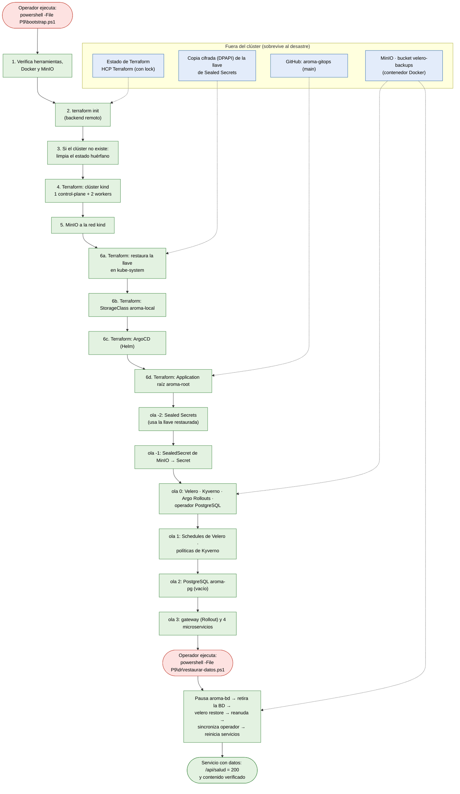

# Práctica 9 — Continuidad operativa y recuperación ante desastres

**Software Avanzado, sección B — USAC, segundo semestre 2026**
**Estudiante:** Jennifer Taperio · **Carné:** 202103763
**Sistema:** café "Aroma": gateway y 4 microservicios con PostgreSQL, en Kubernetes (kind) con GitOps.

---

## 4.1 Tabla de enlaces obligatoria

| Ítem | Enlace o dato |
|---|---|
| **Repositorio GitOps** | https://github.com/lurdesss/aroma-gitops (público, rama `main`) |
| **Aplicación raíz en ArgoCD** | `aroma-root`, namespace `argocd`. Patrón app-of-apps sobre la carpeta [`apps/`](https://github.com/lurdesss/aroma-gitops/tree/main/apps) del repo GitOps. La instala Terraform (`helm_release.aroma_root`, chart `argocd-apps` 2.0.6). |
| **Punto de entrada del bootstrap** | [`P9/bootstrap.ps1`](bootstrap.ps1). Comando: `powershell -ExecutionPolicy Bypass -File P9\bootstrap.ps1` |
| **Backend remoto de Terraform** | Tipo `remote` en HCP Terraform (`app.terraform.io`), organización `VerdictCorp`, workspace `aroma-p9-infra` (execution mode Local). HCP Terraform aplica el bloqueo de estado en cada `plan`/`apply`. Configuración en [`P9/terraform/versions.tf`](terraform/versions.tf). |
| **Schedule de Velero** | `respaldo-horario-aroma` (`0 * * * *`, retención 48 h, `aroma-prod` con volúmenes). Complementarios: `respaldo-diario-aroma` (`0 3 * * *` UTC, 15 días, prod y staging) y `respaldo-llaves` (semanal, 1 año, llave de Sealed Secrets). **Destino:** BackupStorageLocation `default`, MinIO **fuera del clúster** (contenedor Docker `minio`), bucket `velero-backups`. Definición en [`aroma-gitops/backups/schedule.yaml`](https://github.com/lurdesss/aroma-gitops/blob/main/backups/schedule.yaml). |
| **Reconstrucción cronometrada** | Intento 1: [`P9/evidencias/prueba-reconstruccion-20261017-024040.log`](evidencias/prueba-reconstruccion-20261017-024040.log) (bootstrap: [`bootstrap-20261017-024049.log`](evidencias/bootstrap-20261017-024049.log)). Intento 2: [`P9/evidencias/prueba-reconstruccion-20261017-030258.log`](evidencias/prueba-reconstruccion-20261017-030258.log) (bootstrap: [`bootstrap-20261017-030304.log`](evidencias/bootstrap-20261017-030304.log)) |
| **Restauración de datos** | [`P9/evidencias/bloque-8b-ensayo-restauracion.txt`](evidencias/bloque-8b-ensayo-restauracion.txt): pedidos marcados antes y después del backup, borrado de la BD, restauración y verificación del contenido en primaria y réplica. El contenido restaurado tras cada reconstrucción también se verifica en los dos registros de reconstrucción. |
| **Prueba de pérdida de nodo** | [`P9/evidencias/prueba-perdida-nodo-20261017-013734.log`](evidencias/prueba-perdida-nodo-20261017-013734.log) y el detalle por petición en [`.sondas.txt`](evidencias/prueba-perdida-nodo-20261017-013734.sondas.txt) |
| **RTO y RPO declarados** | **Objetivos** (declarados antes de medir en [`P9/dr/OBJETIVOS-RTO-RPO.md`](dr/OBJETIVOS-RTO-RPO.md)): **RTO 15 min** y **RPO 1 h**. **Medidos:** RTO **11 min 28 s** en el intento 1, con intervención para corregir la restauración, y **20 min 38 s** en el intento 2, que **no cumple**. La infraestructura sola se recupera en 8 min 07 s y 9 min 55 s. RPO **10 s** en la prueba de restauración (2 pedidos posteriores al backup perdidos) y **0 pedidos perdidos** en las dos reconstrucciones. |
| **Video demostrativo** | **No entregado.** |

### Documentos de la entrega

| Documento | Criterio |
|---|---|
| [`RUNBOOK.md`](RUNBOOK.md): procedimiento por escenario, con comandos, orden de dependencias y verificación en cada paso | 1.1 Runbook |
| [`INFORME-DR.md`](INFORME-DR.md): los 6 campos de la plantilla 4.2 | 1.2 Informe de DR |
| [Diagrama del bootstrap](#2-diagrama-del-bootstrap-orden-de-reconstrucción-y-dependencias) (sección 2 de este README) | 1.3 Diagrama |
| [`PREGUNTAS-TEORICAS.md`](PREGUNTAS-TEORICAS.md): comportamiento del sistema ante pérdidas y sus límites | 1.4 Preguntas teóricas |
| [`GUIA-CALIFICACION.md`](GUIA-CALIFICACION.md): preparación del día y un comando por criterio | — |

---

## 1. Qué se construyó

| Requisito del enunciado | Cómo se cumple | Dónde |
|---|---|---|
| Bootstrap de día cero, un solo punto de entrada | `bootstrap.ps1` → Terraform crea el clúster kind (1 control-plane y 2 workers), restaura la llave de Sealed Secrets, instala ArgoCD y la Application raíz. ArgoCD levanta el resto por olas (`sync-wave`). | [`bootstrap.ps1`](bootstrap.ps1), [`terraform/bootstrap.tf`](terraform/bootstrap.tf) |
| Estado remoto con bloqueo | `backend "remote"` en HCP Terraform; ningún `*.tfstate` en el repositorio (`.gitignore`). | [`terraform/versions.tf`](terraform/versions.tf) |
| Respaldos programados con Velero | 3 Schedules con retención; volúmenes por Kopia y node-agent (`defaultVolumesToFsBackup`); hook `pg_dumpall` + `CHECKPOINT` antes de copiar PostgreSQL; destino MinIO externo. | `aroma-gitops/apps/velero.yaml`, `aroma-gitops/backups/` |
| Servicio con estado | PostgreSQL 17 con el operador de Zalando (Patroni): StatefulSet de 2 instancias, una por worker, PVC `pgdata-aroma-pg-0/1` en la StorageClass `aroma-local`. Datos reales: 9 productos sembrados y pedidos creados por la API. | `aroma-gitops/bd/postgresql.yaml`, [`terraform/almacenamiento.tf`](terraform/almacenamiento.tf) |
| Continuidad de los secretos | Respaldo de la llave de Sealed Secrets **fuera del clúster y de Git**, cifrado con DPAPI de Windows, y restauración de la llave **antes** de instalar el controlador. Copia secundaria con el Schedule `respaldo-llaves` de Velero. | [`scripts/exportar-llave-sealed-secrets.ps1`](scripts/exportar-llave-sealed-secrets.ps1), [`scripts/restaurar-llave-sealed-secrets.ps1`](scripts/restaurar-llave-sealed-secrets.ps1), [`dr/verificar-secretos.ps1`](dr/verificar-secretos.ps1) |
| Resiliencia ante pérdida de nodo | PDB en todos los servicios y en PostgreSQL; anti-afinidad preferida en los servicios y obligatoria en PostgreSQL; ≥ 2 réplicas en todo `aroma-prod` (gateway 3); probes de arranque, vida y disponibilidad. | `aroma-gitops/charts/aroma-comun/` |
| Flujo de la Práctica 8 conservado | ArgoCD como único aplicador; canary del gateway con Argo Rollouts (3 pasos y 2 `AnalysisRun`); 3 políticas de Kyverno en `Enforce` (prohibir `latest`, exigir límites, exigir no root). Todo vuelve con la reconstrucción. | [`evidencias/bloque-7-canary.txt`](evidencias/bloque-7-canary.txt), [`evidencias/bloque-6-kyverno-cluster.txt`](evidencias/bloque-6-kyverno-cluster.txt) |

### Repositorios

- **Código (este repo):** Terraform, bootstrap, scripts de DR, pruebas, evidencias y documentación en `P9/`. El código de los microservicios es el de `P5/services`, sin cambios desde el tag `v1.0.0`.
- **GitOps:** https://github.com/lurdesss/aroma-gitops. Contiene `apps/` (app-of-apps), `charts/` (un chart por servicio y la librería `aroma-comun`), `bd/`, `politicas/`, `backups/` y `secrets/`, donde solo hay `SealedSecret`.

---

## 2. Diagrama del bootstrap (orden de reconstrucción y dependencias)



**Leyenda:** rojo = acción manual, que es ejecutar un comando; verde = automático; azul = lo que sobrevive fuera del clúster.

- **Pasos manuales: dos comandos.** El bootstrap reconstruye la plataforma y los servicios sin intervención. La restauración de datos es un segundo comando, porque un clúster nuevo nace con una base de datos vacía y elegir qué respaldo restaurar es una decisión del operador.
- **Por qué este orden:**
  - La **llave** debe estar en `kube-system` **antes** de que arranque el controlador de Sealed Secrets. Si no, el controlador genera una llave nueva y los SealedSecrets del repo quedan ilegibles.
  - Velero necesita el Secret de MinIO, que solo se descifra con esa llave. Por eso la llave **no** puede venir de Velero.
  - Las políticas de Kyverno se aplican antes de la BD y de los servicios, para que todo se admita ya con ellas activas.
  - Las olas esperan a que la anterior esté Healthy, gracias al chequeo de salud de `Application` configurado en ArgoCD.

---

## 3. Respaldos y continuidad de secretos

**Respaldos de datos (Velero 1.15, chart 8.1.0):**
- **Destino:** MinIO en un contenedor Docker **fuera del clúster**, con volumen persistente propio y puertos solo en `127.0.0.1`. Un `kind delete cluster` no lo toca.
- **Volúmenes:** se respaldan los archivos con Kopia y node-agent, porque `local-path` no ofrece snapshots CSI.
  - **Hallazgo:** con la StorageClass `standard` de kind los PV son `hostPath` y Velero los omite **sin error**. Por eso PostgreSQL usa `aroma-local` (`defaultVolumeType: local`).
  - **Consecuencia:** los respaldos anteriores a las 06:30 UTC del 17/10/2026 no contienen `pgdata`.
- **Consistencia:** antes de copiar, cada instancia de PostgreSQL escribe un `pg_dumpall` dentro de su propio volumen y fuerza un `CHECKPOINT`. Si el hook falla, el respaldo queda `PartiallyFailed` y el error no se oculta.
- **Verificar que un respaldo tiene datos:** `kubectl get podvolumebackups.velero.io -n velero -l velero.io/backup-name=<backup>`. Mirar la fase del backup no basta: un backup *Completed* puede no tener datos.

**Respaldo de la llave de Sealed Secrets:**
1. **Copia principal, fuera del clúster y de Git:** `P9/scripts/exportar-llave-sealed-secrets.ps1` escribe `%USERPROFILE%\.aroma-p9\sealed-secrets-llave.dpapi`, cifrada con DPAPI. La llave nunca se escribe en claro ni se imprime.
2. **Restauración automática:** Terraform (`null_resource.llave_sealed_secrets`) ejecuta `restaurar-llave-sealed-secrets.ps1` **antes** de ArgoCD. La llave se descifra en memoria y no entra al estado de Terraform.
3. **Copia secundaria:** el Schedule `respaldo-llaves` respalda `kube-system`, filtrando por la etiqueta `sealedsecrets.bitnami.com/sealed-secrets-key`. **Riesgo reconocido:** en MinIO esa copia no está cifrada en reposo.
4. **Prueba:** tras cada reconstrucción, `P9/dr/verificar-secretos.ps1` dio 5/5. Comprueba que la huella del certificado coincide con la de la copia, que el controlador registró la llave existente, que el SealedSecret se descifró, que el Secret existe y que Velero se autentica en MinIO con él.

---

## 4. Pruebas y resultados medidos

| Prueba | Evidencia | Resultado |
|---|---|---|
| Pérdida de nodo: drenaje del worker con la primaria de PostgreSQL | [`prueba-perdida-nodo-20261017-013734.log`](evidencias/prueba-perdida-nodo-20261017-013734.log) | Disponibilidad **96.48 %** (192/199 peticiones) en `/api/salud` y en lectura de la BD. Una ventana de **7.5 s** de HTTP 503 al iniciar el drenaje. Patroni promovió la réplica; los PDB frenaron desalojos peligrosos. |
| Reconstrucción completa, intento 1 (`kind delete cluster`) | [`prueba-reconstruccion-20261017-024040.log`](evidencias/prueba-reconstruccion-20261017-024040.log) | Bootstrap en 8:07. La 1.ª restauración falló por una carrera con el operador; se corrigió el script y se re-ejecutó. **RTO 11:28, con intervención.** 4/4 pedidos y secretos 5/5. |
| Reconstrucción completa, intento 2 | [`prueba-reconstruccion-20261017-030258.log`](evidencias/prueba-reconstruccion-20261017-030258.log) | Bootstrap en 9:55. Solo la primaria recibió `pgdata`. **RTO 20:38, no cumple.** 4/4 pedidos desde la primaria y secretos 5/5. Se reparó después sincronizando las contraseñas. |
| Eliminación y restauración de datos | [`bloque-8b-ensayo-restauracion.txt`](evidencias/bloque-8b-ensayo-restauracion.txt) | Recuperados 9 productos y los 3 pedidos anteriores al backup; **perdidos los 2 pedidos posteriores**, como se esperaba. Bytes de `pgdata` restaurados idénticos a los respaldados. **RPO 10 s.** |
| Canary del gateway | [`bloque-7-canary.txt`](evidencias/bloque-7-canary.txt) | 7 pasos en 2:04 y 2 `AnalysisRun` Successful ("0 fallos de 20"). |
| Políticas de admisión | [`bloque-6-kyverno-cluster.txt`](evidencias/bloque-6-kyverno-cluster.txt) | 3 rechazos reales del webhook y un despliegue de control aceptado; escaneo pass=108, fail=0. |

**Lectura honesta de los resultados:**
- La **plataforma** se reconstruye sola y dentro del objetivo: 8 a 10 minutos.
- **La restauración de datos no es confiable sin intervención.** Depende del orden en que actúan ArgoCD, el operador de PostgreSQL, Velero y el recolector de basura de Kubernetes. Por eso el RTO *automático* no quedó demostrado: el intento 1 necesitó intervención y el intento 2 no cumplió.
- **Causa raíz del intento 2:** los pods restaurados conservan `ownerReferences` al StatefulSet anterior y el recolector de basura borró uno antes de que existiera el StatefulSet restaurado. Además, el operador generó contraseñas nuevas que no coinciden con las de los datos restaurados.
- **Plan para cerrar la brecha:** credenciales fijas de la BD como SealedSecrets en GitOps, y restaurar solo los PVC y los pods, sin `ownerReferences` (resource modifier de Velero), dejando que el operador cree el StatefulSet y adopte los pods.

---

## 5. Límites conocidos y puntos únicos de fallo

- **Una sola laptop:** Docker Desktop, MinIO y la copia DPAPI de la llave están en la misma máquina. Perder la máquina significa perder también los respaldos y la llave. La copia DPAPI solo la descifra esta cuenta de Windows.
- **El `/salud` de los servicios no consulta la base de datos.** Los servicios siguen "Ready" con la BD rota y `/api/salud` puede dar 200 mientras los pedidos fallan.
- **Kubernetes no rebalancea los pods** tras un uncordon. En la prueba de nodo, todas las réplicas estaban en un solo nodo antes de drenar. Ante una caída real, y no un drenaje controlado por PDB, se perderían todas a la vez.
- **Sin RabbitMQ ni `pedidos-worker` en P9.** P9 no los exige, y el gateway y pedidos toleran el broker ausente; la auditoría asíncrona de P5 y P6 no opera.
- **Staging** tiene values propios en cada chart, pero solo se despliega producción, por la memoria disponible.
- **Conexiones a PostgreSQL cifradas pero sin verificación de CA** (`sslmode=no-verify` y `require`), porque el certificado es autofirmado.

---

## 6. Verificación

- **Script oficial del auxiliar:** [`P9/docs/verificar_p9.sh`](docs/verificar_p9.sh), sin modificar.
  - Tiene un error de bash: `"${X:-{}}"` agrega una `}` al JSON y jq falla. Por eso marca 2.3, 2.4 y 2.6 como fallidas aunque los recursos existan, en cualquier máquina.
  - Copia corregida y documentada, que solo cambia esas 7 líneas: [`P9/pruebas/verificar_p9_corregido.sh`](pruebas/verificar_p9_corregido.sh).
- **Resultado tras las pruebas:** [`P9/evidencias/verificador-tras-pruebas.txt`](evidencias/verificador-tras-pruebas.txt). El oficial da 42/60 por su error; la copia corregida da **60/60**.
- **Requisitos:** Git Bash, `git`, `jq`, `kubectl`, `helm`, `terraform` y `velero` en el PATH, y el contexto `kind-aroma-p9`.

---

## 7. Estructura de `P9/`

```
P9/
├── README.md                 este documento (tabla 4.1 y diagrama del bootstrap)
├── RUNBOOK.md                runbook de recuperación
├── INFORME-DR.md             informe de la prueba de DR (plantilla 4.2)
├── PREGUNTAS-TEORICAS.md     preguntas teóricas sobre este sistema
├── GUIA-CALIFICACION.md      preparación y comandos para la calificación
├── bootstrap.ps1             punto de entrada único del bootstrap
├── terraform/                clúster kind, namespaces, cuotas, RBAC, StorageClass, ArgoCD, raíz
├── scripts/                  exportar y restaurar la llave de Sealed Secrets (DPAPI)
├── dr/                       objetivos RTO/RPO, scripts de pruebas, recuperación y preparación
├── pruebas/                  manifiestos que Kyverno debe rechazar, verificador corregido y p9.conf
├── evidencias/               registros con marcas de tiempo de cada prueba
└── docs/                     enunciado y verificador oficial
```
